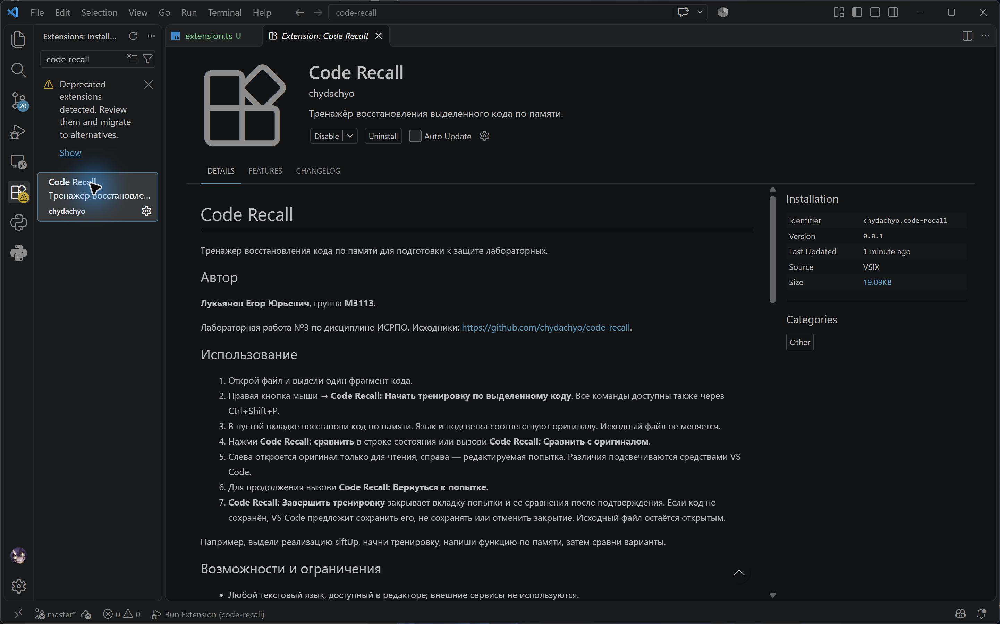
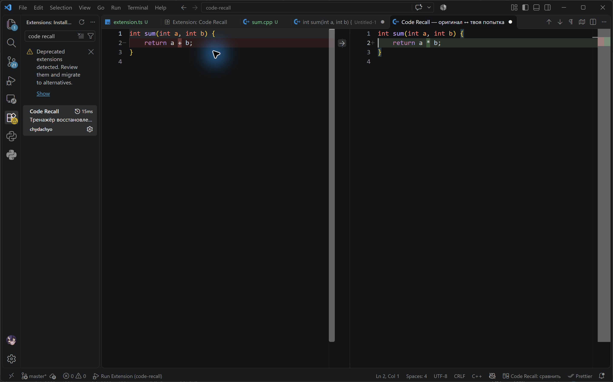

# Code Recall

Тренажёр восстановления кода по памяти для подготовки к защите лабораторных.

## Автор

**Лукьянов Егор Юрьевич**, группа **M3113**.

Лабораторная работа №3 по дисциплине ИСРПО. Исходники: https://github.com/chydachyo/code-recall.

## Использование

1. Открой файл и выдели один фрагмент кода.
2. Правая кнопка мыши → **Code Recall: Начать тренировку по выделенному коду**. Все команды доступны также через Ctrl+Shift+P.
3. В пустой вкладке восстанови код по памяти. Язык и подсветка соответствуют оригиналу. Исходный файл не меняется.
4. Нажми **Code Recall: сравнить** в строке состояния или вызови **Code Recall: Сравнить с оригиналом**.
5. Слева откроется оригинал только для чтения, справа — редактируемая попытка. Различия подсвечиваются средствами VS Code.
6. Для продолжения вызови **Code Recall: Вернуться к попытке**.
7. **Code Recall: Завершить тренировку** закрывает вкладку попытки и её сравнения после подтверждения. Если код не сохранён, VS Code предложит сохранить его, не сохранять или отменить закрытие. Исходный файл остаётся открытым.

Например, выдели реализацию siftUp, начни тренировку, напиши функцию по памяти, затем сравни варианты.

## Возможности и ограничения

- Любой текстовый язык, доступный в редакторе; внешние сервисы не используются.
- Оригинал — снимок выделения: изменения исходного файла не меняют эталон.
- Одна активная тренировка. Перед заменой запрашивается подтверждение, старая попытка не стирается.
- Пустое выделение и несколько выделений отклоняются с подсказкой.
- При полном текстовом совпадении появляется уведомление. При проверке совпадения CRLF и LF равнозначны.
- Это текстовое сравнение: расширение не компилирует код и не оценивает правильность альтернативного решения. Отображение пробелов в diff зависит от настроек VS Code.
- Тренировка хранится в памяти текущего окна до его перезагрузки или отключения расширения. Истории нет.
- При закрытии документа попытки тренировка завершается. Save As может закрыть первоначальный документ и также завершить тренировку. Сохранённый код остаётся в файле.
- Оригинальная вкладка остаётся доступной. Расширение не запрещает подсматривать и не отключает подсказки других расширений.

## Разработка

Требуются Node.js, npm и VS Code версии, указанной в engines.vscode файла package.json.

В PowerShell:

    npm.cmd install
    npm.cmd run compile

Установи рекомендованное расширение connor4312.esbuild-problem-matchers. Нажми F5. В окне Extension Development Host открой файл с кодом и проверь команды Code Recall.

Запуск интеграционных тестов в отдельном VS Code:

    npm.cmd test

Первый запуск тестов может скачивать редактор и требует доступа к сети.

Проверка логики команд без запуска редактора:

    npm.cmd run test:logic

Она использует имитацию VS Code API: проверяет выделение, неизменность оригинала, отмену замены, сравнение, возврат и завершение. Открытие настоящего окна diff проверяют интеграционные тесты и ручной запуск через F5.

Упаковка установочного файла:

    npx.cmd --package @vscode/vsce vsce package

Если vsce недоступен, в проекте есть автономный упаковщик без загрузки пакетов:

    npm.cmd run package:offline

Он создаёт Code Recall в формате VSIX с манифестом и скомпилированным кодом. Это локальная установка, а не публикация в Marketplace. Идентификатор chydachyo используется для локального пакета; регистрация издателя в Marketplace не выполнялась.

Файл .vsix устанавливается через Extensions → … → Install from VSIX.

## Архитектура

- package.json — манифест, команды, контекстное меню и зависимости.
- src/extension.ts — состояние тренировки, обработчики команд, виртуальные оригиналы.
- src/test/extension.test.ts — интеграционные проверки.
- scripts/test-logic.cjs — проверка обработчиков с имитацией API.
- esbuild.js — сборка в dist/extension.js.
- .vscode — настройки отладки и сборки.

VS Code активирует расширение при вызове объявленной команды. Функция activate регистрирует обработчики через Extension API. Класс RecallTrainer хранит оригинал и документ попытки. TextDocumentContentProvider предоставляет оригинал только для чтения, а встроенная команда vscode.diff открывает сравнение. Обработчики и ресурсы освобождаются через context.subscriptions.

## Проверка на примере

Открой examples/sum.cpp, выдели функцию sum и начни тренировку. Напиши return a * b вместо return a + b и сравни варианты. Затем исправь оператор и проверь сообщение о полном совпадении. Заверши тренировку командой через палитру.

Для повседневного использования установи VSIX в обычное окно редактора. F5 нужен только для разработки; после установки запускать отладку не требуется.

## Скриншоты

## Отчёты

Отчёты по созданию расширения и его установке находятся в папке deliverables. Скриншоты показывают реальную установку и применение Code Recall в обычном VS Code.
